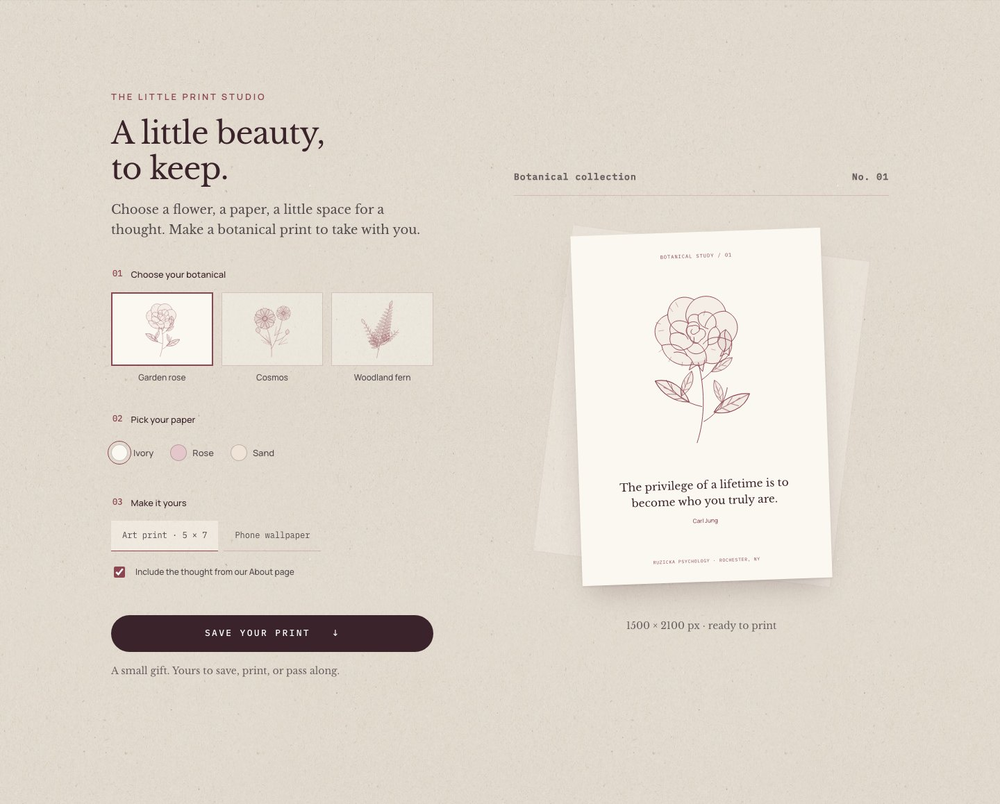
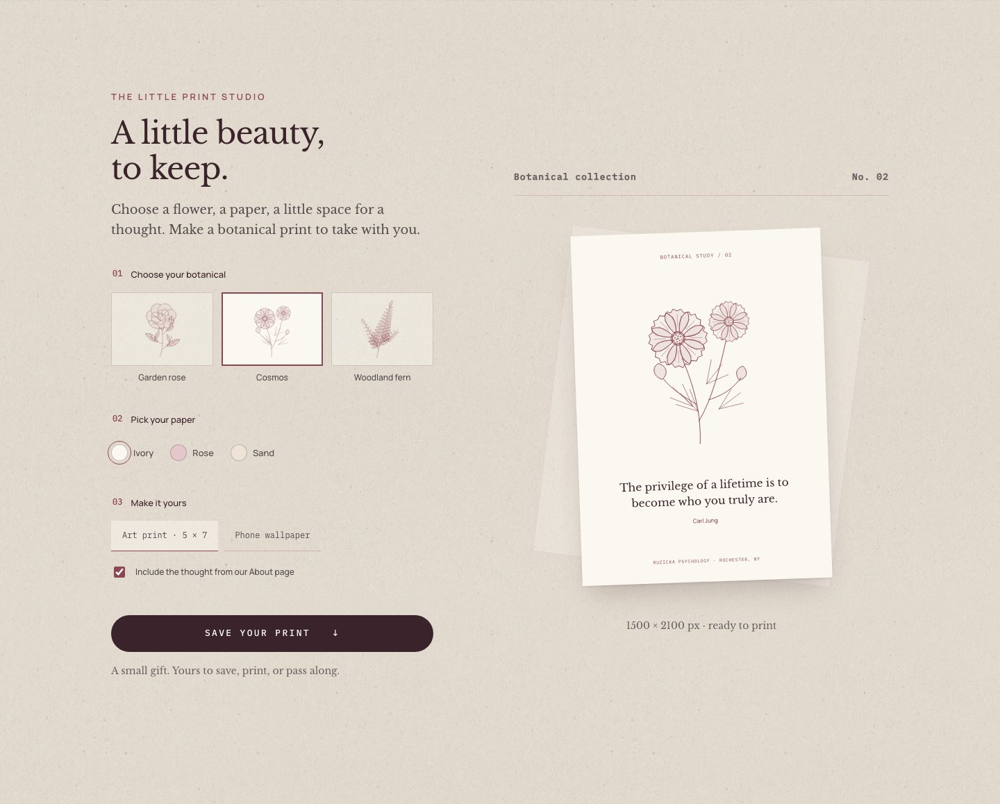
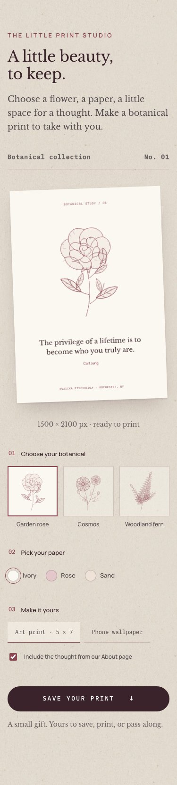

# Exploration 05 — The little print studio

A miniature stationery atelier near the end of the homepage. Visitors choose an original botanical ink drawing, paper color, and format, then download their composition as an actual PNG. No signup, additional image service, or new dependency.

## Experience

- Three original vector studies: garden rose, cosmos, and woodland fern.
- Ivory, rose, and sand papers use the site's semantic palette.
- Art print: 1500 × 2100 px, a 5 × 7 format at 300 pixels per inch.
- Phone wallpaper: 1080 × 1920 px, with quiet space above the artwork for a clock.
- An optional thought comes directly from the About page's published Sanity philosophy quote and attribution. The current quote is attributed to Carl Jung; the experience does not invent words by Christina.
- Actual local site fonts and the selected SVG artwork are drawn into a client-side canvas. The editorial paper tilt is removed from the downloaded image. Nothing is uploaded.
- Native radio controls support keyboard arrows; all choices work on touch screens. Reduced motion removes the short color transition. There are no automatic animations.

## Review

Open `/#print-studio`. Choose another botanical, paper, or format, and press **Save your print**. The mobile/tablet layout places the preview before customization controls; desktop places it alongside them.

Screenshots are captured from the actual running application at 1440, 768, and 375 pixels. `-open` captures show a different botanical selection.

## Validation

`npm run verify:quick` passes (105 tests). `tests/e2e/print-studio.spec.ts` checks both real PNG downloads, dimensions, nonempty image content, selection behavior, accessibility with axe, keyboard navigation, reduced motion, and horizontal overflow. Exported images are attached to the Playwright result for visual inspection. Full CI and the resulting download proofs are coordinated with the exploration review.

This is an independent exploration branch, not a request to merge all eight concepts together. Before shipping, the practice should choose whether it wants to offer a downloadable quote and which botanical artwork best represents its identity.
