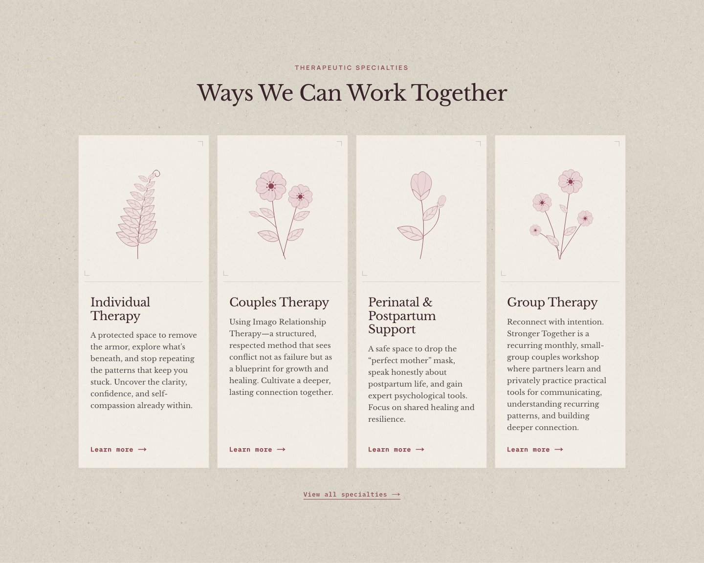
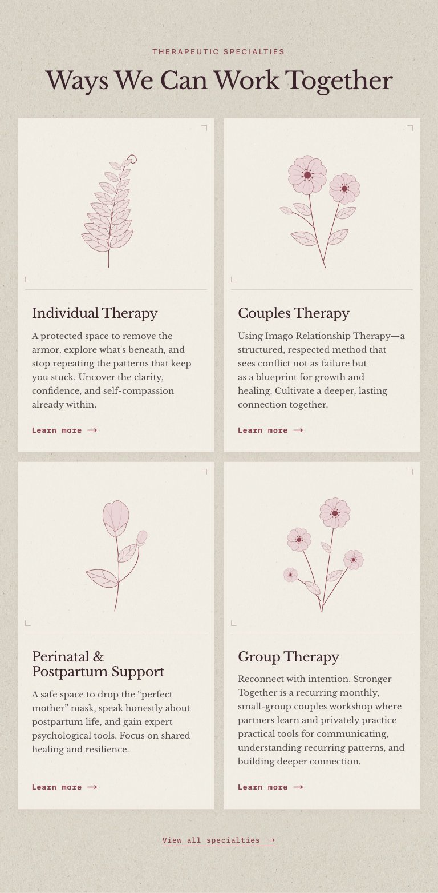
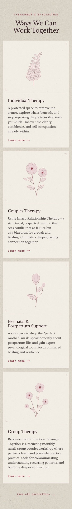

# Botanical specimen cabinet

The homepage specialty collection becomes four small botanical plates: a fern,
paired wild roses, a rosebud, and a meadow of roses. Thin rose-ink outlines, petal
veins, and understated corner marks give the collection a quieter, more tangible
character. Artwork stands alone without flower names, specimen numbers, or
other decorative captions.

The illustrations are original, source-owned SVG drawings. They share the site's
existing palette and remain crisp at any density. No image downloads, animation
library, or additional client JavaScript are needed. The fern's successive
leaflets, paired rose stems, nested bud, and scattered blooms have distinct
silhouettes. Each card is beautiful at rest; hover or keyboard focus introduces a
single 2.4-second gesture. Existing touch-motion coordination activates only the
fully visible specimen nearest the reading position. Reduced motion disables
the gestures completely.

All specialty titles, summaries, publication states, ordering, and navigation
still come from Sanity. Compact versions of the same illustrations appear above the cards on the
specialties overview and beside the introductory label on each matching service
page. These 64 × 80px marks omit fine veins and stay still, keeping the content
primary. All sizes reuse the same SVG artwork and CMS icon mapping.

## Keep the original quadrant layout

The original quadrant version is deliberately retained. **Do not remove it as
unused code: we may switch back to it later.** The botanical version remains
selected for this exploration.

To switch back, set `homeSpecialtiesLayout` to `"quadrant"` in
`src/config/home-specialties.ts`. This restores the two-column divider grid,
38px specialty glyphs, and centered heading. Set it to `"botanical"` to use
the illustrated cards again. Both compositions live in
`src/page-modules/home/specialties/index.tsx` and share the same live CMS content,
published-service links, and section anchor. No CMS migration is needed.

## Review

- Desktop: four plates with aligned service links.
- Tablet: two columns.
- Mobile: one column with generously sized artwork and readable summaries.
- Each published specialty retains a single whole-card accessible link.
- The new layout adds vertical length to the homepage, especially on mobile.
  This is an intentionally stronger editorial presence; review it alongside the
  smaller explorations before selecting a direction.

## Validation

Unit coverage includes both retained layouts and their publication-aware links.
The latest unit suite passed 25 files and 107 tests. Dedicated browser coverage exercises nine widths from 320 to 1440px,
service navigation, keyboard motion, single animation iteration, and reduced
motion. Existing specialty tests cover coordinated touch motion.

## Captured implementation

These are browser captures of the implemented homepage with its real CMS content.
All three were visually inspected after capture.

